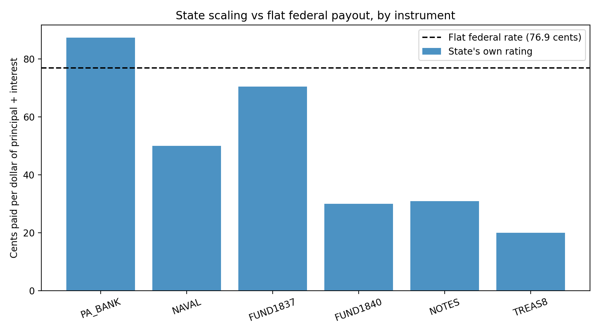

# The Republic of Texas Debt Settlement, 1850-1856

A small reconstructed dataset and analysis of how the Republic of Texas's debt was scaled by the state and settled by the U.S. Congress.

**Authors:** Nandan Ramaswamy **Contact:** contact.nandanr@gmail.com

## Research question
Texas scaled each debt instrument by its estimated value when issued (rated from 25 to 87.45 cents on the dollar). Congress instead paid one amount, $7.75 million, against a revenue debt of about $10.08 million (about 76.9 cents on the dollar). Which instruments gained or lost relative to the state's own ratings?

## Data
- `data/debt_instruments.csv`: debt instruments, amounts, interest, and state ratings.
- `data/purpose_of_debt_1836.csv`: what the Republic's early debt financed.
- `data/DATA_DICTIONARY.md` and `data/SOURCES.md`: definitions and sources.

All figures come from publicly available sources (see `data/SOURCES.md`). Rows are marked `second_person_verified` once independently re-entered.

## Reproduce
```
pip install -r requirements.txt
python analysis/analysis.py
```
Outputs are written to `outputs/`.

## Results
The table below compares the state-scaled value versus the flat federal payout by instrument:

| instrument_id | final_amount | state_scaled_amount | federal_amount | state_effective_rate | federal_minus_state |
|---|---|---|---|---|---|
| PA_BANK | 960,498.00 | 839,955.50 | 738,573.14 | 0.87 | -101,382.36 |
| NAVAL | 1,622,404.70 | 811,202.35 | 1,247,545.06 | 0.50 | 436,342.71 |
| FUND1837 | 1,687,094.80 | 1,189,753.80 | 1,297,288.39 | 0.71 | 107,534.59 |
| FUND1840 | 1,674,380.42 | 502,314.13 | 1,287,511.70 | 0.30 | 785,197.57 |
| NOTES | 2,716,645.29 | 840,994.65 | 2,088,959.32 | 0.31 | 1,247,964.67 |
| UNITEMIZED | 1,417,680.00 | NaN | 1,090,122.39 | NaN | NaN |



## Key assumption and limitations
The federal payment is modeled as a flat percentage of each instrument's final principal plus interest. This must be confirmed against the Act of February 28, 1855. [List any rows still unresolved.]

## Paper
`paper/` contains the written analysis: [LINK]

## License
Code: MIT (see `LICENSE`). Data and text: please cite this repository.
